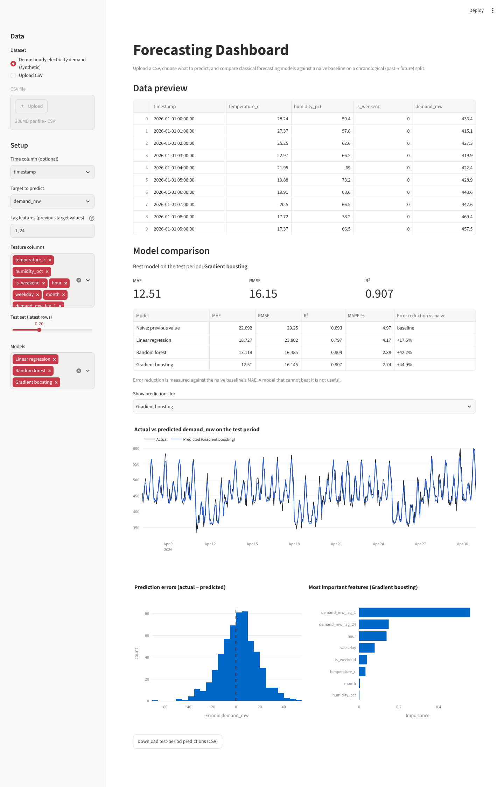
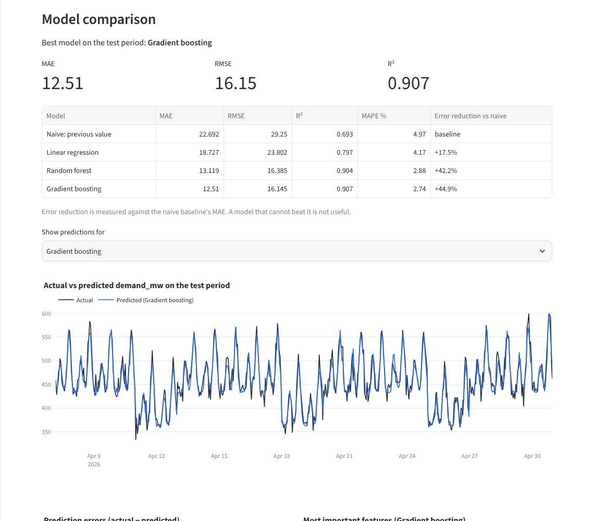

# Forecasting Dashboard

A Streamlit dashboard that compares classical forecasting models on any CSV. It trains on the past, tests on the future, and reports every model's error against a naive baseline, so you can see whether a model actually adds value.



## What it does

- **Any CSV or built-in demo data.** The demo is a *synthetic* hourly electricity-demand series (120 days, with daily and weekly cycles and temperature effects). It is generated in code, so no download is needed.
- **Time-aware setup.** Pick a time column and the app adds hour, weekday and month features, plus **lag features** (the target's value 1 and 24 steps earlier, configurable).
- **Chronological split.** The test set is the latest 10–40% of rows. Shuffling a time series would let the model see the future and inflate scores.
- **Honest comparison.** Linear regression, Random Forest and Gradient Boosting are each scored with MAE, RMSE, R² and MAPE against a **naive baseline**: the previous value for time series, the training mean otherwise.
- **Diagnostics.** Actual-vs-predicted chart for the test period, distribution of prediction errors, feature importance, and a CSV download of the predictions.



On the demo data, gradient boosting cuts the naive baseline's error by about 45% (MAE 12.5 MW vs 22.7 MW), mostly by using the previous hour's demand and the time of day.

## Run it

```bash
python -m venv .venv
source .venv/bin/activate        # Windows: .venv\Scripts\activate
pip install -r requirements.txt
streamlit run app.py
```

## Test it

```bash
pip install -r requirements-dev.txt
ruff check .
pytest -q
```

GitHub Actions runs the same checks on every push.

## Project layout

| File | Purpose |
| --- | --- |
| `app.py` | Streamlit UI |
| `forecasting.py` | Data prep, chronological split, models, metrics (no UI, unit-tested) |
| `tests/test_forecasting.py` | Tests: split order, lag features, models beat the baseline |

## Limitations

- These are classical models. They do not model spatial relationships between locations. An earlier version of this repo was titled "CV-STGCNN" (a spatio-temporal graph neural network), but no such model was ever implemented, so that name was dropped.
- One train/test split, not rolling-origin backtesting.
- Forecasts are one step ahead: each prediction uses the actual previous value as a lag feature.

## Tech stack

Python · Streamlit · scikit-learn · pandas · NumPy · Plotly
