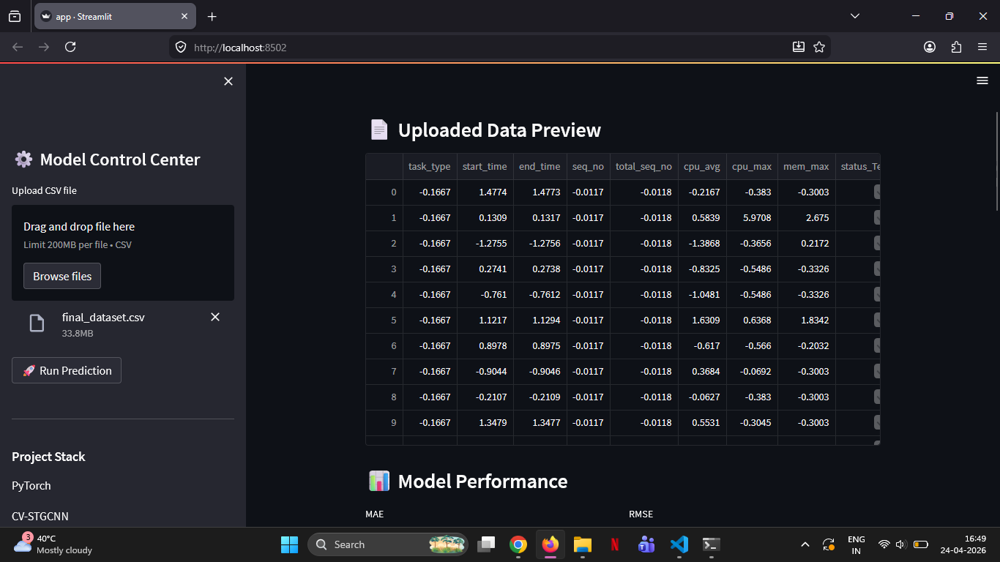
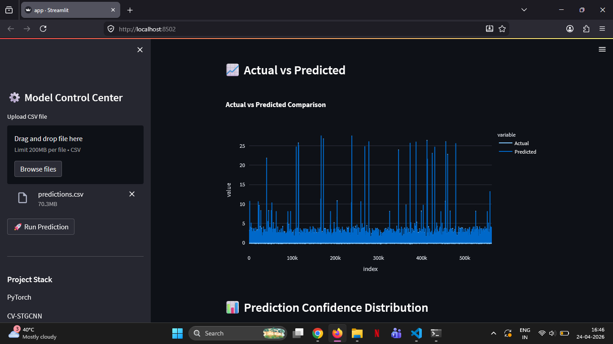
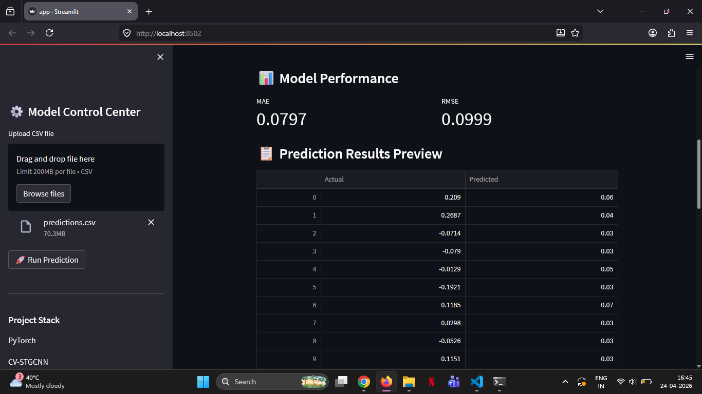
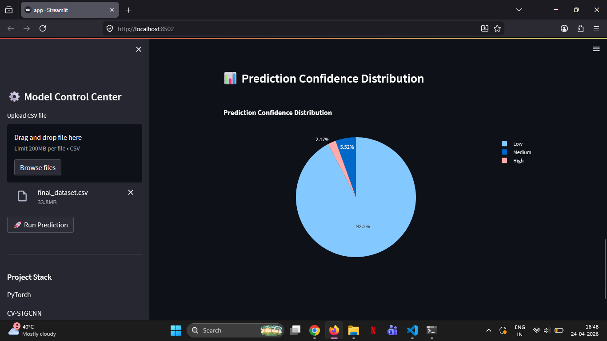

# 🚀 AI Forecasting Dashboard (CV-STGCNN)

An end-to-end deep learning forecasting system with interactive visualization, model evaluation, and explainable insights.

---

## 📸 Dashboard Preview


---

## 📊 Prediction Trend


---

## 📈 Model Performance (MAE / RMSE)


---

## 📉 Prediction Distribution


---

## 🧠 Features
- Spatio-temporal forecasting using deep learning
- Interactive Streamlit dashboard
- Real-time CSV upload & prediction
- Model evaluation (MAE, RMSE)
- Visualization (trend, distribution, correlation)

---

## ⚙️ Tech Stack
- Python
- PyTorch
- Streamlit
- Pandas / NumPy
- Plotly

---

## ▶️ Run Locally
```bash
pip install -r requirements.txt
streamlit run app.py